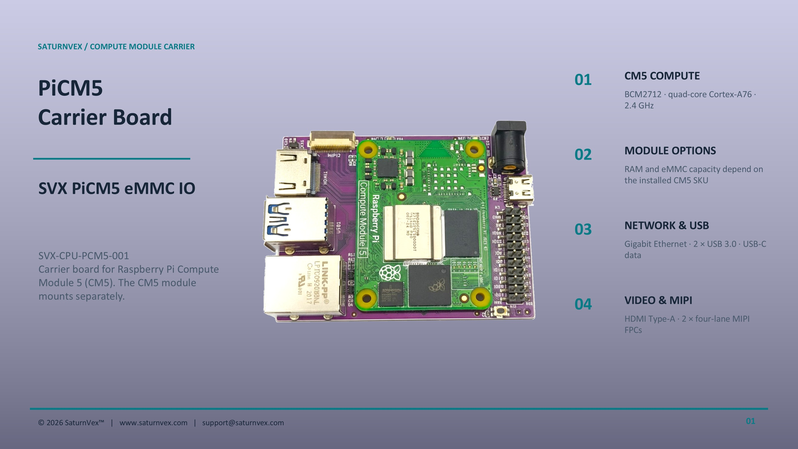
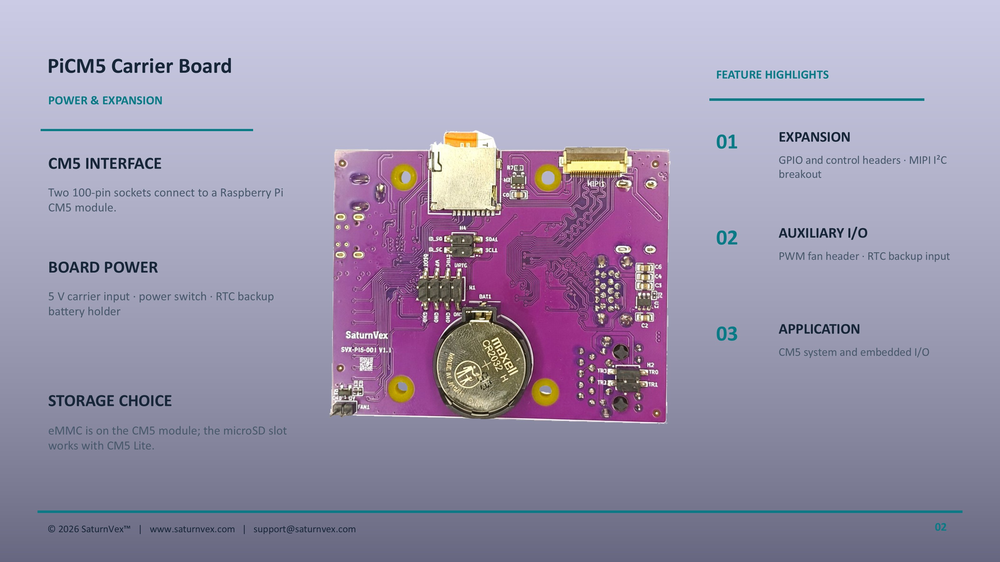
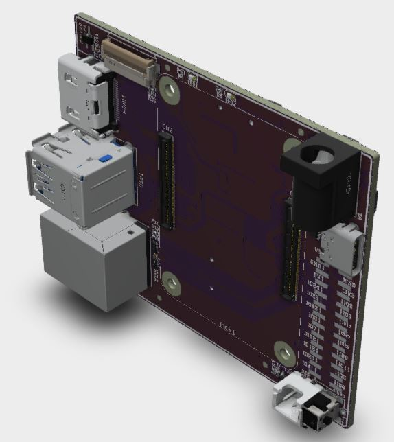

<strong>SATURNVEX · COMPUTE MODULE CARRIER & EDGE AI</strong>

<!-- Product cover images; GitHub constrains content to the README panel width. -->

# SVX-CPU-PCM5 — Raspberry Pi CM5 Carrier Board

*SaturnVex™ — embedded hardware, firmware and Edge AI platforms*

A compact carrier board for the Raspberry Pi Compute Module 5 with Gigabit Ethernet, USB 3.0, HDMI, two MIPI CSI-2 camera connectors and a 20-pin GPIO header. The examples cover board bring-up through to on-device Edge AI: real-time vehicle detection and classification on the CM5 CPU with a camera.

## Product specifications

| Item | Specification |
|---|---|
| Product code | `SVX-CPU-PCM5-001` |
| Compute module | Raspberry Pi Compute Module 5 (BCM2712, quad-core Arm Cortex-A76 up to 2.4 GHz), mounted on two 100-pin sockets; RAM and eMMC capacity depend on the installed CM5 SKU (examples tested with CM5 Lite 8 GB, SC1568) |
| Storage | eMMC on the CM5 module, or microSD slot (Card1) with CM5 Lite |
| Network | Gigabit Ethernet (RJ1) |
| USB | 2 × USB 3.0 host (Type-A); USB-C J1 as USB 2.0 device and for CM5 USB boot (rpiboot) |
| Video & camera | HDMI Type-A; 2 × 22-pin four-lane MIPI CSI-2 camera connectors (MIPI1, MIPI2) |
| Expansion | Header H3 (2 × 12, 2.54 mm): 20 GPIO, UART1, I²C1; jumper headers H1 (USB boot) and H4 (MIPI2 I²C) |
| Auxiliary | PWM fan header FAN1 (CM5 Fan_PWM), RTC backup battery holder, power switch |
| Power | 5 V DC input |
| Software | Raspberry Pi OS 64-bit (Debian 13 "trixie") |
| Test projects provided | MIPI camera, MIPI2 camera, H3 GPIO & UART, USB-C device & USB boot, CPU fan control, BMM350 magnetometer (I²C), vehicle detection & classification (Edge AI) |

## Documentation

| Resource | File |
|---|---|
| **Getting started (module, microSD, first boot)** | [Open](docs/README.md) |
| **Test guides and packages** | [Browse tests](tests/README.md) |
| **Demo video (YouTube)** | [Edge AI vehicle detection on the CM5](https://youtu.be/zJSzV0Tif1g) |
| **Mechanical CAD** | [CAD files / STEP](cad/README.md) |
| **Download all available documentation and code** | [Download complete package](downloads/SVX-CPU-PCM5-001_Complete_Resources.zip) |

## Demo video

*Real-time vehicle detection and classification running on the CM5 CPU with an IMX219 camera (Test 07), shown live in a web browser.*

## Test projects — documentation paired with source

| Test | Test guide (PDF) | Source (ZIP) | Overview |
|---|---|---|---|
| 01 — MIPI Camera (MIPI1 / MIPI2) | [Guide](tests/01-mipi-camera/SaturnVex_PCM5_MIPI_Camera_Test_Guide_EN.pdf) | [Source](tests/01-mipi-camera/PCM5_MIPI_Camera_Test_SaturnVex.zip) | [Open](tests/01-mipi-camera/README.md) |
| 02 — MIPI2 Camera (DPHY1) | [Guide](tests/02-mipi2-camera/SaturnVex_PCM5_MIPI2_Camera_Test_Guide_EN.pdf) | [Source](tests/02-mipi2-camera/PCM5_MIPI2_Camera_Test_SaturnVex.zip) | [Open](tests/02-mipi2-camera/README.md) |
| 03 — H3 GPIO & UART | [Guide](tests/03-gpio-uart/SaturnVex_PCM5_GPIO_UART_Test_Guide_EN.pdf) | [Source](tests/03-gpio-uart/PCM5_GPIO_UART_Test_SaturnVex.zip) | [Open](tests/03-gpio-uart/README.md) |
| 04 — USB-C Device & USB Boot | [Guide](tests/04-usb-c-device/SaturnVex_PCM5_USB_C_Device_Test_Guide_EN.pdf) | [Source](tests/04-usb-c-device/PCM5_USB_C_Device_Test_SaturnVex.zip) | [Open](tests/04-usb-c-device/README.md) |
| 05 — CPU Fan Control | [Guide](tests/05-fan-control/SaturnVex_PCM5_Fan_Control_Test_Guide_EN.pdf) | [Source](tests/05-fan-control/PCM5_Fan_Control_Test_SaturnVex.zip) | [Open](tests/05-fan-control/README.md) |
| 06 — BMM350 Magnetometer (I²C) | [Guide](tests/06-bmm350-i2c/SaturnVex_PCM5_BMM350_I2C_Test_Guide_EN.pdf) | [Source](tests/06-bmm350-i2c/PCM5_BMM350_I2C_Test_SaturnVex.zip) | [Open](tests/06-bmm350-i2c/README.md) |
| 07 — Vehicle Detection & Classification (Edge AI) | [Guide](tests/07-vehicle-classify/SaturnVex_PCM5_Vehicle_Classify_Test_Guide_EN.pdf) | [Source](tests/07-vehicle-classify/PCM5_Vehicle_Classify_Test_SaturnVex.zip) | [Open](tests/07-vehicle-classify/README.md) |

**Getting started:** start with [Test 01 – MIPI Camera](tests/01-mipi-camera/README.md); its guide covers microSD preparation, first boot and SSH login, which the other guides build on. All scripts run on the board under Raspberry Pi OS; the PC side uses Windows PowerShell with the built-in OpenSSH client.

## CAD data

Download the [STEP model](cad/SVX_CPU_PCM5_001.step) for mechanical integration.

## Complete download

[**Download all supplied documentation, STEP CAD and seven paired example packages**](downloads/SVX-CPU-PCM5-001_Complete_Resources.zip).

You can alternatively use **Code → Download ZIP** in GitHub to download the repository.

## Where to Buy

For availability, pricing and purchase inquiries, contact **[support@saturnvex.com](mailto:support@saturnvex.com)**.

## Notes

- The PDFs describe specific test setups and expected results, not a blanket certification claim.
- SaturnVex source files are provided under the BSD-3-Clause license (`LICENSE.txt` in each package). Raspberry Pi OS, its packages, the Bosch BMM350 SensorAPI and the AI models keep their own licenses (`NOTICE.txt`).
- The Raspberry Pi Compute Module 5 is not included with the carrier board. Raspberry Pi and Compute Module are trademarks of Raspberry Pi Ltd; SaturnVex is not affiliated with Raspberry Pi Ltd.
- All header I/O is 3.3 V logic. Connect cameras, sensors and cables only with the board powered off.

---
© 2026 **SaturnVex™** · [www.saturnvex.com](https://www.saturnvex.com) · support@saturnvex.com
