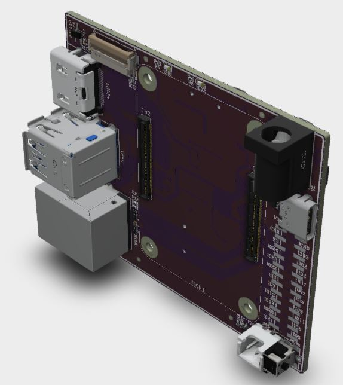

# Mechanical CAD

3D model of the SVX-CPU-PCM5-001 carrier board. The Raspberry Pi CM5 module mounts on the two 100-pin sockets.
Verify connector positions, mounting holes and clearances from the STEP model before designing an enclosure.

- [Download STEP 3D CAD model](SVX_CPU_PCM5_001.step?raw=true)
- [View CAD rendering](SVX_CPU_PCM5_001_CAD_3D_View.jpg)

[← Product home](../README.md)
